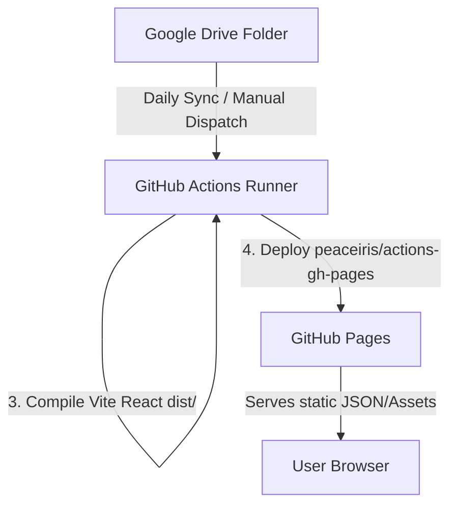

# r/WarRobotsGuide Database & Automated Sync Pipeline

A high-performance, responsive web application for `r/warrobotsguide`, featuring an automated CI/CD pipeline that regularly fetches data from a Google Drive folder and redeploys the site based on the updated spreadsheets and guides.

The frontend is built as a static Single Page Application (SPA) using **React** and **Vite** with custom vanilla CSS glassmorphism, designed to be hosted directly on **GitHub Pages**.

---

## 🛠 Architecture Overview



1. **Google Drive Sync (`scripts/fetch_gdrive.py`)**: Checks for credentials. If present, it authenticates via a Google Service Account, lists the contents of the configured Google Drive folder, downloads `.xlsx` and `.docx` files, and saves them to the `sample data/` folder.
2. **Parser Script (`scripts/parse_data.py`)**: Runs next. It uses `pandas`, `openpyxl`, and `python-docx` to extract text descriptions and cell-style configurations (such as role association color fills) and exports them as normalized JSON files in `src/data/`.
3. **Frontend Bundle**: Vite compiles the React project, bundling the parsed JSON directly into the final client assets (`dist/`). This enables a standalone, zero-database serverless architecture with instant, highly responsive client-side searching and filtering.

---

## 📂 Project Structure

- **`/sample data`**: Directory containing raw spreadsheet and Word files (.xlsx, .docx).
- **`/scripts`**:
  - `fetch_gdrive.py`: Download files from Google Drive using Google API client.
  - `parse_data.py`: Parser to convert raw Excel/Word documents into structured JSON.
- **`/src`**:
  - `/data`: Folder containing generated JSONs (`tiers.json`, `robot_guide.json`, `weapons_dps.json`, `specializations.json`, `pilots.json`).
  - `App.jsx`: Main React application with tab routing, comparison tools, search, and custom SVG charts.
  - `index.css` & `App.css`: High-end custom styling system, featuring dark modes, glowing headers, HSL variables, and interactive animation frames.
- **`index.html`**: Entry point for the Vite project.
- **`.github/workflows/deploy.yml`**: GitHub Actions pipeline for building and deploying to GitHub Pages.

---

## 🚀 Setup & Local Development

### 1. Python Parser Setup (Local)
Create a Python virtual environment and install the required dependencies:
```bash
# Create a venv
python -m venv venv

# Activate and install packages
source venv/bin/activate
pip install pandas openpyxl python-docx google-api-python-client google-auth-httplib2 google-auth-oauthlib
```

### 2. Run Data Parser
Parse raw files to JSON locally:
```bash
./venv/bin/python scripts/parse_data.py
```
This updates the files in `src/data/`.

### 3. Start Frontend Dev Server
Install npm dependencies and launch the dev server:
```bash
# Install node packages
npm install

# Start Vite hot-reload server
npm run dev
```

### 4. Build and Preview Production
```bash
# Compile bundle
npm run build

# Preview local production build
npm run preview
```

---

## Shared page styling

React components generate the page content. `scripts/prerender.js` copies the built
HTML shell and sets route metadata; Vite supplies the shared stylesheet link.

- Use `PageHero` for the heading and description on guide pages.
- Reuse `src/shared.css` for common card, modal, icon, and layout styles. It loads
  after `src/App.css` so the extracted styles retain their existing overrides.
- Put new static presentation in CSS with descriptive classes. Keep inline styles
  for values calculated from data or measurements, such as rating colors, score
  widths, and the sliding tab indicator position.
- When extracting styles from an element with existing classes, check selector
  specificity, hover states, and responsive rules. Some unique static styles still
  live inline and can be migrated as their components are refactored.

`npm run build` checks that every generated route references the same stylesheet
assets and that the HTML shell contains no embedded styles.

## 🔗 Automated CI/CD Setup

The deploy workflow restores a cache of `sample images/`, then mirrors the complete
Google Drive image folder with four parallel download workers. Each worker owns its
own Drive client. Set `GDRIVE_DOWNLOAD_WORKERS` to a value from 1 to 8 to tune this.

The cache manifest records Drive file IDs, checksums, modification metadata, and
local content hashes. New, changed, renamed, or locally corrupted files download
again; unchanged files reuse the cache. Deleted files and folders are removed only
after all folder pages have been listed and all required downloads succeed. A
missing/inaccessible folder, incomplete listing, duplicate destination, invalid
path, failed download, or checksum mismatch stops the deploy instead of pruning.
The old mirror is kept until the verified replacement is ready to publish.
Rate-limit and transient network/server failures retry with exponential backoff,
random jitter, and `Retry-After` support.

`sample images/` is a dedicated mirror: don't store unrelated local files there.
The cache is saved after a successful sync, with a key based on the manifest's
contents so unchanged snapshots aren't uploaded again. Cache eviction simply
causes a fresh download on the next run. No Drive credentials are stored in it.

The generated `public/images/items/` and `public/images/icons/` directories are
rebuilt before creating the image manifest. This removes stale website images and
restores the standard render when a high-quality override is deleted. Image
generation errors fail the build; an absent local `sample images/` directory keeps
existing generated assets for local development.

Run the offline sync regression tests (no credentials or Drive requests):

```bash
python -m unittest discover -s scripts/tests -v
```

To enable the automated synchronization from Google Drive:

### 1. Create a Google Service Account
1. Go to the [Google Cloud Console](https://console.cloud.google.com/).
2. Create a project, enable the **Google Drive API**.
3. Create a **Service Account** under IAM & Admin -> Service Accounts.
4. Generate a new key in **JSON format** and download it.
5. Copy the email address of the service account.

### 2. Share the Google Drive Folder
1. Open the Google Drive folder containing your spreadsheets and guides.
2. Click **Share** and grant **Viewer** permissions to the Service Account email.
3. Copy the **Folder ID** from the folder URL: `https://drive.google.com/drive/folders/<FOLDER_ID>`.

### 3. Add GitHub Repository Secrets
Go to your GitHub Repository -> Settings -> Secrets and Variables -> Actions, and add the following secrets:
- **`GDRIVE_FOLDER_ID`**: The Folder ID copied from the Google Drive URL.
- **`GDRIVE_CREDENTIALS_JSON`**: The entire content of the downloaded Service Account JSON key file.

Once added, the GitHub Actions runner will connect to Google Drive, pull the latest guides, parse them, compile, and deploy the new build to GitHub Pages automatically every day at midnight, on push to `master`, or when manually triggered via the **Run workflow** button.

## Content metadata and regression checks

The Value Ratings methodology is imported from `Methodology text.docx`.
The weapon DPS workbook Intro marker controls the current game version and
version-scoped NEW badges. Equipment history is restored from the last successful
deployment and published with the next successful site build. See
[Equipment metadata](docs/equipment-metadata.md) for rollover and bootstrap rules,
and [Module artwork](docs/module-artwork.md) for supplemental asset sources.

```bash
python -m unittest discover -s scripts/tests -v
npm test
npm run lint
npm run validate:data
npm run build
```

Browser regression tests open tier-list details in Chromium at desktop and mobile
sizes. They verify that the title and rationale keep their visible text contrast
when the decorative artwork is shown, and that the close button works. The tests
compare rendered text with and without the background layer, so changing guide
content does not require updating screenshot baselines.

```bash
npx playwright install chromium --only-shell
npm run test:browser
```

On Linux, use `npx playwright install --with-deps chromium --only-shell` if browser
system libraries are missing. `test:browser` builds the production site and starts
its own preview server on port 4173. CI runs these checks on pull requests and
pushes to master. Contrast failures include actual/reference text images; browser
failures also save a page screenshot and trace in the
`browser-test-diagnostics` artifact. Run
`npx playwright show-report` to inspect a local failure.
